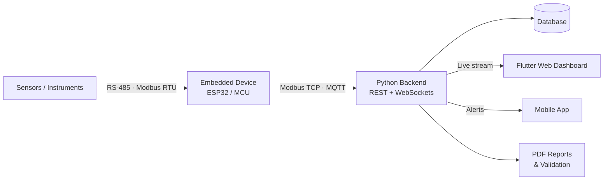

# Hi, I'm Appu M 👋
### Senior Application Engineer · Flutter · Embedded C/C++ · Industrial IoT

**I build the layer between hardware and software:** firmware, serial/network protocols, cloud backends, and real-time dashboards that industrial teams rely on.

  
  
  

📍 Mysuru, India &nbsp;|&nbsp; 💼 Herin Electronics &nbsp;|&nbsp; 🟢 Open to Embedded + Flutter / IoT roles

---

## 👨‍💻 About Me

I specialize in **hardware-connected software systems**: Flutter apps and web dashboards that talk directly to embedded devices over **RS-485, Modbus RTU/TCP, MQTT, WebSockets and TCP/IP**.

At **Herin Electronics** I've progressed from Application Engineer to **Senior Application Engineer** in under 4 years, owning work across Flutter, device communication, backend APIs, real-time dashboards, and automated PDF reporting.

**Currently exploring:** Edge AI, local LLMs for PDF verification, anomaly detection, and SCADA-style dashboards.

---

## 📊 Impact at a Glance

| | |
|:---|:---|
| 🚀 **Experience** | 3.5+ years across Flutter, embedded and IoT |
| 📈 **Career growth** | Application Engineer → Software Development Engineer → Senior Application Engineer |
| 📱 **Reach** | 5,000+ combined app installs |
| ⚡ **Performance** | 40% lower server load after migrating HTTP polling to WebSockets |
| 🤖 **Automation** | 30% less time spent on reporting |

---

## 🛠️ Tech Stack

| Domain | Technologies |
|:---|:---|
| **Mobile & Frontend** | Flutter, Dart, Flutter Web, Flutter Desktop, Android, iOS |
| **Embedded** | Embedded C/C++, ESP32, ESP-IDF, Arduino, LVGL, UART |
| **Protocols & IoT** | Modbus RTU/TCP, RS-485, MQTT, WebSockets, TCP/IP |
| **Backend & Data** | Python, SQL, REST APIs, Firebase, AWS |
| **AI & Automation** | Local LLMs, OCR, PDF extraction & validation, report automation |
| **Tools** | Git, Linux, Postman, Excel automation, serial/protocol debugging |

---

## 🏗️ How My Systems Fit Together

---

## 💼 Experience

### Senior Application Engineer · Herin Electronics
*Dec 2025 – Present*

- Architected the full-stack **HEIoT Real-Time Dashboard** (Flutter Web, Python, WebSockets).
- Migrated live sensor updates from HTTP polling to WebSocket streaming, **cutting server load by 40%**.
- Coordinate Firmware, Backend and Mobile teams to ship features end to end.
- Own Modbus/TCP-to-cloud data consistency across industrial IoT devices.
- Designed automated PDF reporting and a live alert engine for sensor streams.

### Software Development Engineer · Herin Electronics
*Jan 2025 – Nov 2025*

- Built real-time chart modules and live alert feeds for Modbus sensor data.
- Implemented offline sync and subscription management for mobile fleet apps.
- Improved RS-485 communication reliability between hardware and app layers.
- Contributed to scalable data pipelines for industrial monitoring.

### Application Engineer · Herin Electronics
*Jan 2023 – Dec 2024*

- Shipped cross-platform Flutter apps with **5,000+ combined installs**.
- Built **Calibration Suite**, a Flutter Desktop app for Modbus RTU over RS-485.
- Automated metrology certificate generation, reducing manual reporting effort.
- Developed **FleetTrack Pro**: GPS tracking, geofencing, subscriptions and payments.
- Delivered the team's first direct hardware-to-app integration, reading sensor registers over a serial bus.

---

## 🚀 Featured Projects

| Project | Type | Stack | Outcome |
|:---|:---|:---|:---|
| [**HEIoT Dashboard**](http://anvay.herin.in) | Industrial IoT platform | Flutter Web, Python, WebSockets | Real-time charts, PDF reports, live alerts |
| **Calibration Suite** | Desktop / embedded | Flutter Desktop, Modbus RTU, RS-485 | Direct register reads and certificate automation |
| **FleetTrack Pro** | Mobile app | Flutter, Maps API | Live GPS, geofencing, subscriptions, payments |
| **PDF Extraction & Validation** | AI pipeline | Python, local LLM (Gemma), OCR | Offline extraction and validation of calibration reports, including scanned PDFs |
| **ESP32 Calibration Voltage Reader** | Firmware | ESP32, C++, UART, LVGL | Reads calibration voltage over UART and shows it on a touch display |

---

## 🔭 What I'm Exploring

- **Edge AI:** lightweight inference on embedded and industrial hardware
- **Local LLMs:** PDF verification, anomaly explanation, report generation
- **Real-time IoT:** MQTT QoS tuning, WebSocket optimization, low-latency ingestion
- **Industrial dashboards:** SCADA-style visualization with Flutter Web and canvas rendering

---

## 🎓 Education & Certifications

- **MCA**, Karnataka State Open University, 2025 · CGPA 8.45
- **BCA**, Davangere University, 2022 · CGPA 8.9
- **HackerRank:** Software Engineering · SQL (Intermediate)

---

## 📈 GitHub Stats

More activity

---

### 🤝 Open to roles in Embedded + Flutter · IoT Systems · Real-time Architecture

&nbsp;

